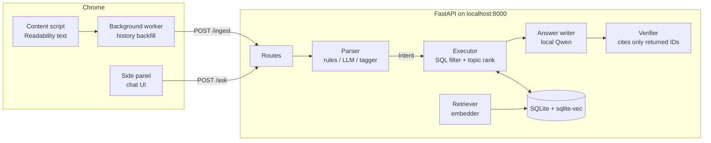

# Breadcrumbs

**Breadcrumbs: History Assistant** answers questions about your own browsing history, such as "what was the last movie I watched?", "what did I search 2 days ago?" or "which ramen pages did I open last week?", and links every answer to the history entries it came from.

It is a Chrome extension with a side-panel chat, backed by a FastAPI service on your own machine. Storage (SQLite with sqlite-vec), the retriever and the reply LLM (a local Qwen model) all run locally. There is no hosted API, and your history never leaves your laptop.

> Status: scaffold. The ingest, storage, executor, verifier and API paths run end to end with stub models. The parsers, the fine-tuned retriever and the LLM are being built in `ml/`.

## How it works

**Ingest**

1. On install, on browser startup and whenever the side panel opens, the extension syncs `chrome.history` since the last successful sync (the first sync covers 90 days). Visits are sent with title and URL; reloads are not counted, and history browsed while the backend was down is picked up on the next sync.
2. A content script also extracts each page's main text with Mozilla Readability. The visit time comes from Chrome's history, so the text attaches to the same entry instead of creating a duplicate. Google searches are stored as `kind: "search"` with the `q=` query text.
3. The backend validates each entry, stores one row per visit or search in SQLite (UTC timestamps), splits page text into chunks, and embeds them into a sqlite-vec index.

**Ask**

1. The user types a question in the side panel, which calls `POST /ask`.
2. The **parser** turns it into an **Intent**: kind (search, visit or any), time range, topic, limit and order. `now` and the timezone are passed in, so time phrases resolve the same way every run.
3. The **executor** fetches matching entries with a SQL filter on kind and time range, then ranks them by topic with the retriever's embeddings.
4. The **answer writer** (local LLM) writes a one- or two-sentence reply citing entries by ID.
5. The **verifier** drops any reply that cites an entry the executor didn't return, and falls back to a template answer. The ranked list is shown either way.



## Repo layout

```text
extension/      Daniel   WXT + React + TypeScript: background backfill, content script, side panel
backend/        Daniel   FastAPI, Pydantic, SQLite + sqlite-vec, ingest, executor, delete, verifier
ml/             Aditya   retriever, parsers, LLM client, answer writer, training and model eval
fixtures/       shared   hand-written seed history and dev / held-back question sets
eval/           shared   evaluation harness and pass bars
tests/mutants/  shared   deliberately wrong builds the test suite must catch
scripts/        shared   demo-check, fixture hash check
docs/           shared   time-phrase rules, decision log, design specs and plans
```

Each owner's area has its own `CLAUDE.md` for coding agents. The root `CLAUDE.md` lists the invariants every change must keep.

## Tech stack

| Layer | Choice |
| --- | --- |
| Extension | WXT 0.21 (Manifest V3), React 19, TypeScript 6, Mozilla Readability |
| Backend | Python 3.12, FastAPI, Pydantic v2, Uvicorn |
| Storage | SQLite (Python `sqlite3`) with sqlite-vec for vectors |
| Retriever | sentence-transformers; stock all-MiniLM-L6-v2 until the fine-tuned model lands |
| Reply LLM | Local Qwen; the runtime (Ollama, MLX-LM or llama.cpp) is decided in `ml/CLAUDE.md` |
| API client | TypeScript types generated from the backend's OpenAPI schema (openapi-typescript) |
| Package managers | uv (Python workspace: `backend`, `ml`), Bun (extension) |
| Tests | pytest, Vitest |
| CI | GitHub Actions: tests, fixture hashes, OpenAPI drift, extension build |

## Getting started

Requirements: [uv](https://docs.astral.sh/uv/), [Bun](https://bun.sh), and Chrome 116 or later (side panel API).

```bash
# Backend
uv sync --all-packages
cp backend/.env.example backend/.env
uv run uvicorn app.main:app --app-dir backend     # http://localhost:8000/health

# Extension
cd extension
bun install
bun run build                                     # or: bun run dev
```

Load the extension: open `chrome://extensions`, turn on Developer mode, click **Load unpacked**, and pick `extension/dist/chrome-mv3`. Click the toolbar icon to open the side panel. The manifest has a fixed `key`, so the extension id matches `EXTENSION_ORIGIN` in `backend/.env.example`.

Other commands:

```bash
uv run pytest                                     # Python tests (backend + ml + scripts)
cd extension && bun run test && bun run typecheck # extension tests
DB_PATH=$PWD/data/demo.db uv run python -m app.seed --reset   # seed a separate demo DB (refuses to wipe real history)
./scripts/demo-check                              # seed, then held-back eval with replayed LLM responses
uv run python backend/scripts/export_openapi.py && (cd extension && bun run gen:api)   # after API changes
```

Configuration lives in `backend/.env`. `PARSER`, `EMBEDDER` and `LLM_MODE` select the model implementations; see `backend/CLAUDE.md`.

## API

| Method and path | Purpose |
| --- | --- |
| `GET /health` | `{status, embedder_version, parser, llm_mode}` |
| `POST /ingest` | `{entries: [{kind, url, query?, title, visit_time, text?, source}]}` → `{ids}` |
| `POST /ask` | `{question, tz, now?}` → `{question, intent, results, answer, mode, timings_ms}` |
| `DELETE /entries/{id}` | Removes the entry, and its vectors when no other entry uses the page |

`mode` is `llm`, `template` (LLM off, unavailable or rejected by the verifier) or `no-match`. The full schema is in `backend/openapi.json`.

## Evaluation

The core claim: starting from a seeded history and a fixed "now", the parser labels held-back questions with the correct Intent at or above the pass bars, the executor returns exactly the expected entries for every correct Intent, and no answer cites an entry that isn't in the database. The pass bars are in `eval/pass_bars.toml`, the time rules in `docs/time-rules.md`, and the wrong builds the suite must catch in `tests/mutants/README.md`. Fixtures and expected answers are written by hand, and the held-back questions are never shown to coding agents.

## Privacy

- Permissions: `history`, `sidePanel`, `storage`. Host permissions: `http://localhost:8000/*` (the backend) and `<all_urls>` (to read page text).
- Everything is stored in a local SQLite file (`data/breadcrumbs.db`), and all inference runs locally.
- Only synthetic seed data is committed or demoed. Real-history mode runs only on your own machine.

## Team

| Name | Responsibility |
| --- | --- |
| Daniel Lam | Chrome extension, ingestion, SQLite database, vector index, executor, deletion, verifier, and the data formats for the seed history and fixtures |
| Aditya Ramaswamy | Retriever and NLP: parsers, local LLM, answer writer, and the trained-model track (training-data generator, training and evaluation) |

Shared: the Intent schema, the time-phrase rules, the seed history contents, the expected answers, and the evaluation harness.

## Dependencies and attribution

Chrome Extensions API (Manifest V3), WXT, React, Mozilla Readability, Python, FastAPI, Pydantic, Uvicorn, SQLite, sqlite-vec, sentence-transformers (all-MiniLM-L6-v2), Qwen, Hugging Face transformers, datasets and seqeval (model track), pytest, Vitest, openapi-typescript, uv and Bun. The parser rules, executor, verifier, fixtures and evaluation harness are our own work.
