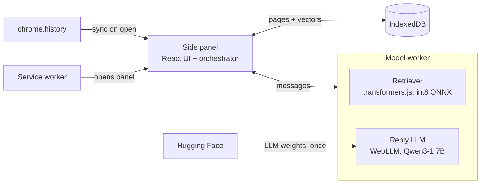

# Breadcrumbs

**Breadcrumbs: History Assistant** is a Chrome extension that answers questions about your own browsing history ("that laptop review site I was reading", "the show I was watching last night") and links you back to the pages. Everything runs inside the browser: a fine-tuned retriever finds candidate pages, and a small local LLM writes the reply. There is no backend server, no paid API, and your history never leaves your machine.

## How it works

Answering a question is a two-hop pipeline.

1. **Permission.** On first run the user grants the `history` permission. Nothing happens before that.
2. **Sync on open.** Each time the user clicks the extension icon, the side panel opens and syncs: it pulls history from Chrome since the last sync, removes pages the user has deleted, and embeds any new pages. While the panel stays open, it also picks up pages visited during the chat.
3. **Ask.** The user types a question in the panel.
4. **Hop 1, retriever.** The fine-tuned retriever embeds the question and scores it against every stored page. The top 10 pages come back in under a second and are shown immediately.
5. **Hop 2, reply LLM.** The local LLM reads the question and those 10 pages and writes a one- or two-sentence reply in a fixed JSON shape, citing pages by number.
6. **Verify and show.** Every citation is checked against the list the retriever returned. The panel shows the reply with clickable citation chips above the ranked list.

If the LLM is unavailable (no WebGPU, not downloaded yet, or turned off), the app still shows hop 1's ranked list on its own.



## The two models

| Model | What it is | Trained by us | Where it comes from |
| --- | --- | --- | --- |
| Retriever | all-MiniLM-L6-v2 (22M params), fine-tuned on ORCAS click data rewritten into conversational questions | Yes | Bundled in the extension as int8 ONNX, about 23 MB |
| Reply LLM | Qwen3-1.7B, 4-bit, thinking mode off | No, used as is | Weights downloaded once from Hugging Face (about 1 GB), then cached |

The retriever is the only model we train. The LLM's job is narrow: pick from 10 titles and write a sentence or two.

## Data: from Chrome history to retriever input

The retriever was trained on one string per page, `title | url`, for example:

```text
Best Budget Laptops 2026 | rtings.com/laptop
```

The extension turns each Chrome history entry into that exact string with `toEntryText(title, url)` in `packages/core/entryText.ts`. Its output must match the Python code that built the training set byte for byte, and a golden-file test enforces this.

Rules applied at sync time:

- **One page per normalized URL.** Many visits to a URL fold into one entry. The page id is a hash of the normalized URL.
- **Google searches** (`google.com/search?q=…`) are stored as `kind: "search"`, and the extracted query text is embedded.
- **Empty or generic titles** ("Untitled", "Home") fall back to words from the URL path.
- **Skipped entirely:** `chrome://`, `chrome-extension://`, `about:`, `file://`, `localhost`, new-tab pages, and sign-in or redirect URLs.
- **Title changes** trigger re-embedding of that page.

## Repo layout

```text
breadcrumbs/
  extension/                 WXT + React + TypeScript
    entrypoints/
      background.ts          service worker: opens the side panel, nothing else
      sidepanel/             React UI and orchestration (sync, rank, verify, render)
    workers/model.worker.ts  all inference: retriever + reply LLM
    public/models/           exported retriever (ONNX + tokenizer + retriever.json)
                             and the bundled WebLLM model library (.wasm)
  packages/core/             pure TypeScript, no chrome.* calls, fully unit-tested
    entryText.ts             toEntryText, URL normalization, noise filter
    rank.ts                  dot-product scoring, top-K, no-match threshold
    prompt.ts                LLM prompt builder
    verify.ts                citation verifier
    history-source.ts        HistorySource interface
  fixtures/
    seed_history.json        synthetic history for demos and tests
    golden/                  Python-generated entry texts and embeddings for parity tests
  scripts/
    export_retriever.py      fine-tuned model → int8 ONNX in extension/public/models/
```

`HistorySource` has two implementations: one reads `chrome.history`, the other loads `fixtures/seed_history.json`. Demo mode and every test use the fixture, so real history is never needed for development or grading.

## Tech stack

| Layer | Choice |
| --- | --- |
| Extension framework | WXT 0.21.x (Manifest V3, Vite 8) |
| Language | TypeScript 6 |
| UI | React, Tailwind CSS |
| Retriever runtime | Transformers.js 4.x (`@huggingface/transformers`), WASM backend |
| Reply LLM runtime | WebLLM 0.2.85 (`@mlc-ai/web-llm`), WebGPU, in a Web Worker |
| Storage | Dexie 4 over IndexedDB |
| Package manager | Bun |
| Tests | Vitest (unit), Playwright (end-to-end against the built extension) |
| Model export | Python with uv, sentence-transformers, Hugging Face Optimum |
| CI | GitHub Actions: tests, then `wxt zip` |

WebLLM and Transformers.js are pinned to exact versions because the model files and runtimes must match. Upgrade them only on purpose, and rerun the parity tests when you do.

## Getting started

Requirements: Bun, Chrome 113 or later with WebGPU, and Python with uv (only for exporting the retriever).

```bash
bun install
bun run dev        # opens Chrome with the extension loaded; the panel reloads on save
bun run test       # Vitest unit tests for packages/core and the extension
bun run build      # production build in extension/.output/
bun run zip        # store-ready zip via wxt zip
```

To export a newly trained retriever:

```bash
uv run scripts/export_retriever.py --model path/to/fine-tuned-model
```

This writes the int8 ONNX file, tokenizer and `retriever.json` (version tag, pooling, normalization, max length) into `extension/public/models/history-retriever/`. Bump the version tag in `retriever.json` whenever the model changes; the extension re-embeds all pages when it sees a new version. Until the fine-tuned model is exported, the same code runs stock all-MiniLM-L6-v2.

### Demo mode

Turn on "Demo history" in settings, or start the dev build with `DEMO=1`. The panel loads `fixtures/seed_history.json` instead of real history and shows a "Demo history" badge.

## Using the extension

1. Click the toolbar icon to open the side panel.
2. On first run, grant history access and click **Index my history**. The first index takes a few minutes; later opens only embed new pages.
3. Optionally click **Download reply model** (about 1 GB, one time). Results work without it.
4. Ask a question. The ranked list appears immediately, and the reply streams in above it.
5. Click a citation chip or a row to open the page.

Settings: reply model on or off, domains to exclude, re-index, clear all stored data, and a debug mode that shows each row's raw score and the exact entry text the retriever saw.

## Output contract

Every question produces one object. The UI renders it, and the evaluation harness logs it.

```json
{
  "question": "that show I was watching last night",
  "mode": "llm",
  "results": [
    {"rank": 1, "pageId": "p_9f3a", "kind": "visit", "title": "The Bear | Watch on Hulu",
     "url": "https://www.hulu.com/watch/...", "lastVisit": "2026-10-27T21:14:00-05:00",
     "visitCount": 3, "score": 0.78}
  ],
  "reply": {"text": "You were watching The Bear on Hulu [1].", "cited": ["p_9f3a"]},
  "timingsMs": {"embed": 12, "search": 3, "llmFirstToken": 900, "llmTotal": 2400},
  "retrieverVersion": "minilm-ft-v1"
}
```

`mode` is `llm`, `retriever-only` (LLM off, unavailable or failed) or `no-match` (top score below the threshold tuned on dev questions). The timing values in this example are illustrative, not measurements.

## Storage and caching

| Store | Key | Holds |
| --- | --- | --- |
| `pages` | `pageId` | kind, url, title, entryText, lastVisitTime, visitCount, embedding (Float32Array), retrieverVersion, needsEmbed |
| `meta` | `key` | lastSyncTime, retrieverVersion, settings |

The LLM is downloaded once and never again unless we change its pinned version:

- The retriever ships inside the extension and is never downloaded.
- LLM weights download only from the first-run screen, never in the middle of a question. On each panel open the worker checks the cache and loads from it, in parallel with history sync.
- The extension requests `unlimitedStorage` and calls `navigator.storage.persist()` so Chrome does not evict the weights.
- The cache belongs to the extension id. The manifest `key` is fixed so the id, and therefore the cache, stays the same across rebuilds, machines and the published version.

## Privacy and permissions

Permissions: `history`, `sidePanel`, `storage`, `unlimitedStorage`, `favicon`. There are no host permissions and no content scripts; the retriever only needs titles and URLs.

Nothing leaves the machine except the one-time download of LLM weights. Questions, history and vectors stay in IndexedDB. "Clear all data" removes IndexedDB and the model cache.

## Rules for contributors and coding agents

These invariants hold everywhere. A change that breaks one is rejected, even if tests pass.

1. **No remote code.** Every executable file (JS, ONNX Runtime `.wasm`, WebLLM model library `.wasm`) ships in the package. Only LLM weight files are fetched at runtime. Chrome Web Store rules require this.
2. **No network calls for inference.** No server, no hosted API, no telemetry.
3. **`packages/core` never calls `chrome.*`** and never reads the clock or randomness; inputs such as the current time are passed in. This keeps it deterministic and testable.
4. **`toEntryText` must match training.** Do not change it without regenerating `fixtures/golden/` from the Python side and passing the parity test.
5. **The LLM can only cite pages the retriever returned.** The verifier drops any reply that cites something else and falls back to the ranked list.
6. **All inference runs in the model worker.** The side panel only renders and orchestrates.
7. **Fixtures, golden files and expected answers are written by humans.** Agents do not edit `fixtures/`; propose changes instead.
8. **Never weaken a test to make it pass.**

## Testing

- `toEntryText` against the Python golden file.
- Embedding parity: TypeScript embeddings reach cosine similarity of at least 0.99 with the Python ones.
- Retrieval parity: dev-set Recall@5 in the extension lands within about 1 point of the Python evaluation.
- Verifier: rejects out-of-range and duplicate citations, accepts valid ones.
- Sync: a deleted Chrome visit removes its page and vector; a renamed title triggers re-embedding.
- End to end on the seed fixture: fixed questions return expected pages in the top 5, with the LLM replaced by recorded replies so runs are deterministic.

## Roadmap

1. WXT skeleton: side panel opens from the toolbar icon.
2. History sync into IndexedDB, from Chrome or the seed fixture.
3. Retrieval with stock MiniLM: questions return ranked results. First demoable build.
4. Fine-tuned retriever swapped in; parity tests pass.
5. Reply model: WebLLM loads, JSON reply renders with citation chips, verifier in place.
6. Polish: first-run flow, error states, settings, debug mode.

Not yet in scope: date and time phrases in questions ("last week", "2 days ago"). Time adjustment will slot in between scoring and the top-K cut in `rank.ts` without changing the UI or storage.
